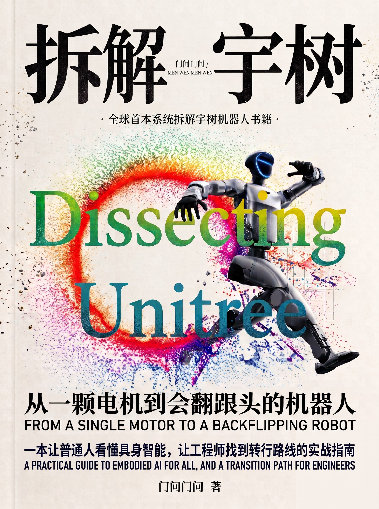
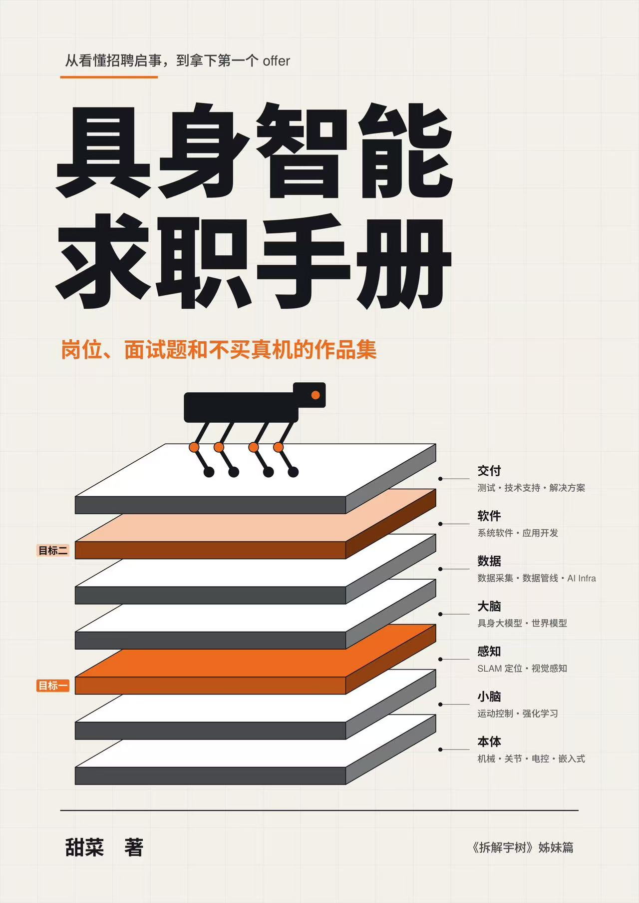

<div align="center">

# 具身智能：从拆解一台机器人，到看懂一个行业

**三本书 · 一部拆解视频 · 一套证据优先的写作方法论**

看懂一台机器人 → 看懂一个行业 → 拿到一个 offer

</div>

> 机器人会翻跟头了，新闻却只告诉你"量产在即"。
> 这个仓库想做相反的事：把机器人拆开、把产业链铺平、给每个产品标出证据阶段——
> 让普通人看懂具身智能，让工程师找到转行路线，让求职者拿下第一个 offer。

---

## 三本书，三个问题

| 书 | 回答的问题 | 一句话定位 | 资料截止 |
|---|---|---|---|
| 《拆解宇树》 | 一台机器人是怎么造出来的？ | 从一颗电机到会翻跟头的机器人 | 2026-10 |
| 《具身智能：机器、部件与全产业链》 | 这个行业怎么来的、谁在造什么？ | 八十年技术谱系，每个产品标出证据阶段 | 2026-11-07 |
| 《具身智能求职手册》 | 我该怎么进去？ | 岗位、面试题和不买真机的作品集 | 2026-10 |

三本均为独立写作的样书（2026 年 10–11 月第 1 版），互为参照，也可单独阅读。每本同时提供 **PDF**（印刷版式）与 **EPUB**（电子书阅读器/手机）。

---

## 01 · 拆解宇树 / Dissecting Unitree

<div align="center">

</div>

> 从一颗电机到会翻跟头的机器人。
> 一本让普通人看懂具身智能、让工程师找到转行路线的实战指南。—— 门问门问 著

全书按一条叙事线推进：**认识它 → 拆开它 → 让它动 → 让它懂 → 看懂这门生意**。

- **认识它**：从一只叫 XDog 的机器狗开始，十分钟读懂一张机器人参数表；
- **拆开它**：外壳即骨架 → 肌肉（电机、减速器、一体化关节）→ 能量与神经（电池、电源、通信）→ 感官（激光雷达、相机、IMU）→ 大脑（算力板与软件分层），能拆能修，才算设计完了；
- **让它动**：站稳的物理学（ZMP、倒立摆）、步态与模型预测、强化学习与仿真，直到后空翻、秧歌和醉拳——表演和干活，是两回事；
- **让它懂**：建图定位导航、灵巧手、遥操作、VLA 与世界模型，瓶颈是数据；
- **看懂这门生意**：便宜的秘密——成本、供应链和商业模式。

配套拆解视频（约 87 MB，MP4，在线无法播放时请下载观看）：
[宇树拆解视频_封面修正_最终版.mp4](拆解宇树书籍/宇树拆解视频_封面修正_最终版.mp4)

阅读：[PDF](拆解宇树书籍/拆解宇树.pdf) · [EPUB](拆解宇树书籍/拆解宇树.epub)

---

## 02 · 具身智能：机器、部件与全产业链

> **具身智能：机器、部件与全产业链**
> 八十年技术谱系 · 每个产品标出证据阶段 —— 甜菜 著

不堆热词的行业全景。全书五部、二十余章，把"新闻里的机器人"还原成"工程与生意里的机器人"：

- **地图**：具身智能是什么；怎么读一条机器人新闻——七级阶段刻度，证据要和断言匹配；
- **来路**：1940 年代 Unimate → Shakey → 雷伯特的腿 → Roomba/Kiva → RT-1/RT-2 与 VLA，八十年一条谱系，讲清每一步"留下了什么"；
- **身体**：机械臂、轮子（AGV/AMR）、四足与轮足、人形、灵巧手，以及无人机、水下、外骨骼、手术机器人；
- **部件与供应链**：关节、感官、能量/算力/实时控制、ROS 2 与仿真工具链，成本花在哪里、降价从哪里来、风险有哪三个；
- **大脑**：机器人基础模型的五层地图（2024–2026）——推理、世界模型、动作策略、集成系统、基础设施分层比较，不把数据集、模型、产品排成一条单线。

本书的硬规则：**演示 ≠ 测试 ≠ 试点 ≠ 交付 ≠ 量产**；全球视野、中美对照，补充欧洲、日本、韩国；证据不足就写"尚未公开"。

阅读：[PDF](具身智能全产业链/具身智能全产业链-内文(1).pdf) · [EPUB](具身智能全产业链/具身智能全产业链(1).epub)

---

## 03 · 具身智能求职手册

<div align="center">

</div>

> 从看懂招聘启事，到拿下第一个 offer。《拆解宇树》姊妹篇。—— 甜菜 著

- **看清这一行**：2026 年谁在招、招什么、薪资怎么看；一张岗位地图——本体、小脑、感知、大脑、数据、软件、交付，二十多个岗位各干什么；
- **按岗位补能力**：运动控制（PID → MPC → WBC）、强化学习（PPO、Sim2Real）、感知与定位（标定、SLAM、状态估计）、操作与具身大模型（模仿学习、VLA、数据）、硬件（结构、关节、电控、嵌入式）——每岗都有知识地图、面试题与参考答案、"从哪些背景转过来最顺"；
- **不买真机的作品集**：让 Go2 站起来、倒立摆 PID 与 LQR、PPO 训练 Hopper、卡尔曼滤波融合 IMU 与腿式里程计等六个项目，全部在 **4 核 CPU、无显卡的 Linux 机器（Python 3.13）** 上运行通过；
- **拿到 offer**：简历把过去的经验翻译成机器人公司的话、面试追问链、offer 拆解与比较、90 天行动计划。

书中招聘启事、简历和面试对话除特别注明外，均为按常见写法改写或虚构的示例；招聘与薪资变化快，请以最新信息为准。

阅读：[PDF](具身智能招聘-求职一本通/具身智能招聘-求职一本通-内文.pdf) · [EPUB](具身智能招聘-求职一本通/具身智能求职手册.epub)

---

## 适合谁读

| 你是 | 建议入口 |
|---|---|
| 对机器人好奇的普通读者 | 《拆解宇树》：不需要专业背景，从参数表和一颗电机讲起 |
| 想转行的工程师、行业研究者 | 《拆解宇树》+《全产业链》：先建立身体直觉，再铺开八十年谱系与供应链地图 |
| 求职者、应届生、转岗者 | 《求职手册》：岗位地图 → 面试题 → 作品集 → 90 天计划 |

建议顺序：先拆一台（建立直觉），再看全链（建立地图），最后做作品集（建立证据）。

---

## 写作方法论：证据优先

这套书共用同一套写作协议，也是本仓库最想留下的东西：

- **来源分级 P1–P5**：原始论文 → 公司/监管公告 → 独立测试与标准 → 高质量产业媒体 → 宣传材料，公司宣传只算"公司声称"；
- **产品阶段 R–M**：研究 / 演示 / 测试 / 试点 / 订单 / 交付 / 量产，七级刻度，每个判断写明依据与未知项；
- 不把"会识别"写成"会操作"，不把"已交付"写成"已量产"；数字必须注明来源、日期与测试条件。

完整写作总提示词已开源，可复用于你自己的研究写作：
[claude-opus-embodied-ai-book-prompt.md](具身智能全产业链/claude-opus-embodied-ai-book-prompt.md)

仓库另附出版工作流学习资料 [36-claude-prompts-英汉对照版.md](具身智能全产业链/36-claude-prompts-英汉对照版.md)（英汉对照，**仅供个人学习研究，版权归原作者 Nespola.io 所有，请勿传播或商用**）。

---

## 仓库结构

```text
.
├── 拆解宇树书籍/             《拆解宇树》PDF/EPUB、封面、拆解视频、介绍图
├── 具身智能全产业链/          《全产业链》PDF/EPUB、写作总提示词、出版学习资料
├── 具身智能招聘-求职一本通/    《求职手册》PDF/EPUB、封面
└── README.md
```

## 版权与声明

- 三本书均为作者独立写作的样书，与宇树科技及书中提到的任何公司无关联；公司、产品与模型名称是其各自所有者的商标；
- 书中插图均为作者根据公开资料绘制的示意图，数据来源写在图注里；不使用产品照片，也不使用 AI 生成图像冒充真实照片；资料检索、写作与插图制作中使用了 AI 工具，已如实披露；
- 内容不构成对任何公司的评价或投资建议；
- 书籍著作权归作者（门问门问 / 甜菜）所有，保留所有权利；学习资料著作权归原作者所有。

## 作者与反馈

**门问门问**（《拆解宇树》）／ **甜菜**（《全产业链》《求职手册》）。

发现事实错误、过时信息或排版问题，欢迎提 Issue 指正——证据优先，从勘误开始。

如果这个仓库让你对具身智能的理解前进了一步，欢迎点一个 Star。